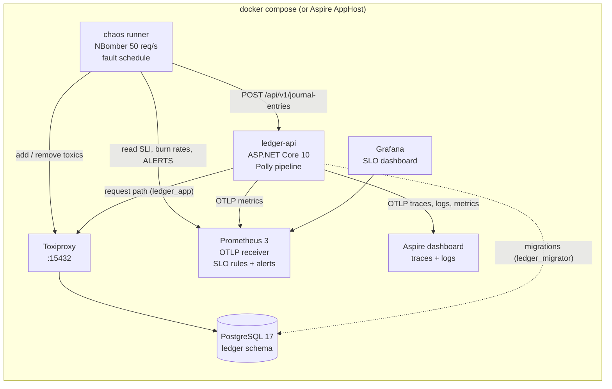
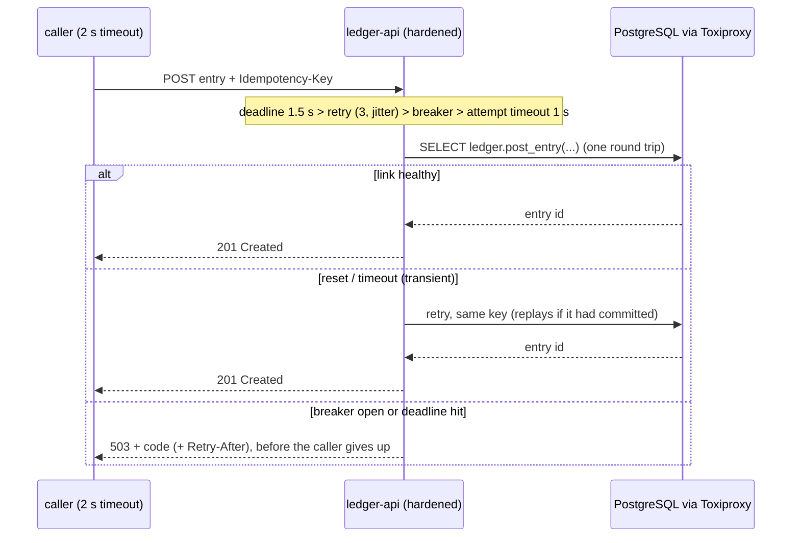

# slo-chaos-lab

[](https://github.com/hekimcan206/slo-chaos-lab/actions/workflows/ci.yml)
[](https://github.com/hekimcan206/slo-chaos-lab/actions/workflows/codeql.yml)
[](LICENSE)
[](global.json)

An SRE lab, not a product: a ledger posting service on PostgreSQL gets availability and p50/p95/p99 latency SLOs,
multiwindow burn-rate alerts and a dashboard; then five network faults are injected between the service and its
database at a fixed load, each one measured, written up as a blameless postmortem, fixed where it exposed a weakness,
and measured again.

**Headline finding.** During a full partition, 98 % of posts failed for their callers while the availability SLO read
**100 %**: every request was still waiting on the database when its 2 s caller hung up, so the server recorded 499
("client closed request"), not 5xx, and the availability alert never fired. With a request deadline shorter than the
caller's timeout and a circuit breaker, the same partition shows up as 97 % 5xx, pages within seconds, and failed posts
return in about 1 ms instead of 2 s. ([Postmortem 5](docs/postmortems/05-partition.md))

All data is synthetic; no real personal or financial data is used.

## Problem

SLO dashboards are easy to build and easy to trust. Whether they tell the truth during an incident, and whether the
service behind them degrades gracefully, only shows when something breaks. This lab breaks the most common thing, the
network between a service and its database, in five controlled ways, and checks three questions each time:

1. What did callers experience? (client-side measurement of every request)
2. What did the SLO and the alerts say? (server-side SLI read back from Prometheus)
3. How much error budget did it cost, and does a code or configuration change make it cheaper?

## Solution

| Piece | What it is |
|---|---|
| Service under test | `POST /api/v1/journal-entries` from [ledger-recon](https://github.com/hekimcan206/ledger-recon) (same author, vendored and attributed per file): exactly-once posting with idempotency keys, ordered row locks, balanced-entry and append-only invariants enforced by PostgreSQL 17 |
| Telemetry | OpenTelemetry traces, metrics and logs. Traces and logs go to the Aspire dashboard; metrics are pushed over OTLP to Prometheus' native receiver ([ADR 0002](docs/adr/0002-observability-stack.md)) |
| SLOs | Availability 99.9 %; latency 50 % within 25 ms, 95 % within 100 ms, 99 % within 250 ms; 30 days, request-based, defined in code ([docs/slo.md](docs/slo.md)) |
| Alerts | Google SRE Workbook multiwindow, multi-burn-rate: 14.4x over 1 h and 5 m, 6x over 6 h and 30 m (pages), 1x over 3 d and 6 h (ticket); generated from the SLO catalog, promtool-tested ([ADR 0003](docs/adr/0003-slos-and-multiwindow-burn-rate-alerts.md)) |
| Dashboard | Grafana, provisioned as code: SLIs, budget, burn rates against the 6x/14.4x lines, latency quantiles, alert timeline, connection pool, bytes on the link, retry and breaker outcomes |
| Faults | Toxiproxy between the service and PostgreSQL: latency, jitter, bandwidth cap, TCP reset bursts, black-hole partition |
| Load | NBomber, open model at a fixed 50 req/s, 2 s caller timeout, from a container on the compose network ([ADR 0006](docs/adr/0006-experiment-method.md)) |
| Fixes | Behind one switch (`LAB_PROFILE=hardened`): single-round-trip posting function ([ADR 0005](docs/adr/0005-single-round-trip-posting.md)); request deadline below the caller's timeout, jittered retries made safe by idempotency, circuit breaker, load shedding, tight Npgsql timeouts and pool size ([ADR 0004](docs/adr/0004-timeouts-retries-breaker-and-load-shedding.md)) |

## Architecture





## Why this design

- **Server-side and client-side numbers, side by side.** The lab's most important result (postmortem 5) only exists
  because the runner measured what callers saw and compared it with what the SLI saw.
- **SLOs as code.** One catalog drives the recording rules, the alerts, the runner's budget arithmetic and the docs; a
  golden test and promtool unit tests keep the YAML honest.
- **Burn rate, not thresholds.** A two-minute blip costs fractions of a percent of a month's budget and should not
  page; a total outage should page in about a minute. Both behaviours are measured below.
- **Fix the protocol before adding resilience.** Experiment 1's fix is not a timeout or a retry: it removes three of
  four round trips, which helps every latency and bandwidth fault at once.
- **Retries only because writes are idempotent.** The ledger's idempotency key turns a retry after an ambiguous commit
  into a replay; without it, the reset fix would double-post.
- **The lighter stack that still does the job.** Prometheus evaluates rules and alerts, Grafana only draws, the Aspire
  dashboard keeps traces and logs; no collector, no all-in-one image ([ADR 0002](docs/adr/0002-observability-stack.md)).

## Quick start

```bash
docker compose up
```

Builds the images, starts PostgreSQL, Toxiproxy, the API (hardened profile), Prometheus, Grafana and the Aspire
dashboard, then the `demo` container sends steady load, partitions the database and exits 0 when
`LedgerPostAvailabilityFastBurn` fires (CI runs exactly this). While it runs:

| | |
|---|---|
| Grafana SLO dashboard | http://localhost:58300 |
| Prometheus (rules, alerts) | http://localhost:58390/alerts |
| Aspire dashboard (traces, logs) | http://localhost:58388 |
| API + Scalar UI | http://localhost:58380/scalar |
| Toxiproxy admin | http://localhost:58474/proxies |

`LAB_PROFILE=baseline docker compose up` runs the service as vendored (no fixes). Local development with the debugger:
`dotnet run --project src/SloChaosLab.AppHost` (same topology, Aspire dashboard included). The experiments:
[docs/experiments.md](docs/experiments.md).

## Results (measured)

Host: Windows 11 laptop, Intel i7-13620H (16 logical CPUs), 16 GB RAM, Docker Desktop 29.9 (WSL2 VM, 16 CPUs,
7.6 GB), shared with another project's containers. Every number comes from [docs/results](docs/results) (JSON per run);
method and environment in [docs/benchmarks.md](docs/benchmarks.md). Fault phase = 120 s at 50 posts/s; "before" is the
baseline profile, "after" the hardened profile.

**Baseline (no fault, 50 posts/s; median of three 60-120 s windows):** baseline profile p50 5.0 ms, p95 10.9 ms, p99 16.7 ms; hardened profile p50 4.1 ms, p95 7.6 ms, p99 17.4 ms; 100 % available in both, apart from one host stall (110 timeouts in a no-fault window, disclosed in [benchmarks](docs/benchmarks.md)).

| Experiment | Variant | Availability (callers) | Availability (SLI) | p50 / p95 / p99 | Within 250 ms | Budget used: availability / p99 | Max burn 5 m: availability / p99 | Page |
|---|---|---:|---:|---|---:|---:|---:|---|
| [1 latency +100 ms](docs/postmortems/01-latency.md) | before | 100 % | 100 % | 408 / 450 / 606 ms | 0.4 % | 0 % / 0.461 % | 0x / 66.4x | p99 fast burn |
| | after | 100 % | 100 % | 105 / 109 / 166 ms | 99.7 % | 0 % / 0.001 % | 0x / 0.5x | none (p95 slow burn) |
| [2 jitter 0-80 ms](docs/postmortems/02-jitter.md) | before | 100 % | 100 % | 184 / 256 / 288 ms | 93.2 % | 0 % / 0.032 % | 0x / 4.3x | p95 slow burn |
| | after | 100 % | 100 % | 59.7 / 81.5 / 86.0 ms | 99.93 % | 0 % / 0 % | 0x / 0.1x | none |
| [3 bandwidth 4 KB/s](docs/postmortems/03-bandwidth.md) | before | 100 % | 100 % | 418 / 449 / 615 ms | 0.32 % | 0 % / 0.461 % | 0x / 66.4x | p99 fast burn |
| | after | 100 % | 100 % | 127 / 130 / 220 ms | 99.97 % | 0 % / 0 % | 0x / 0.1x | none (p95 slow burn) |
| [4 TCP reset bursts](docs/postmortems/04-connection-reset.md) | before | 96.8 % | 97.05 % | 4.4 / 9.7 / 56.4 ms | 100 % | 0.148 % / 0 % | 21.5x / 0x | availability fast burn |
| | after | 99.47 % | 99.5 % | 4.1 / 10.7 / 138 ms | 99.83 % | 0.025 % / 0.001 % | 3.4x / 0.2x | none (ticket) |
| [5 partition](docs/postmortems/05-partition.md) | before | 1.52 % | **100 %** | failures: 2,001 ms (caller timeout) | - | 4.56 % client, **0 % SLI** / - | **0x** / 63.1x | availability: **never** |
| | after | 0 % | 2.9 % | failures: 0.96 ms p50, 3.8 ms p95 | - | 4.83 % client, 4.69 % SLI / - | 652x / 5.3x | availability fast burn, 10 s |

Latency columns are client-observed percentiles of successful posts (nearest rank, every request). Budget is the share
of a 30-day budget at 50 posts/s used by the whole run. "Page" is the measured result from the run's own Prometheus,
whose long windows only hold the run; on a long-running service (steady-state model) the partition's fast-burn page
fires after 52-54 s and the shorter latency faults would not page at all. That is the policy working: two minutes of
+100 ms cost 0.46 % of the p99 budget, a ticket, not a 3 a.m. call.

What the numbers say:

- Posting was four round trips; on a slow link it cost four times the link latency. One round trip fixed the p99
  objective under latency, jitter and bandwidth faults. The p95 objective (100 ms) is not reachable on a 100 ms link
  by any code change; it still alerts, correctly.
- Retries with jitter cut reset-burst failures by 83 % (192 to 32) and removed the page; idempotency keys made them safe.
- The partition result is the reason to measure at the caller: the server-side availability SLI was blind until the
  service learned to fail before its caller gave up.
- The hardened partition run spent slightly *more* budget (4.83 % against 4.56 %): nothing can succeed with the
  database unreachable, and recovery cost 254 posts while the breaker and pool reset. The gain is fast, visible,
  paged failure, not fewer failures.

Capacity (no fault, offered rate steps): both profiles sustained every step up to 800 posts/s (the highest tried on this shared laptop); at 800/s p99 was 338 ms for the interactive baseline (objective breached) and 23 ms for the hardened service. Single runs, two steps hit by host stalls; tables in [benchmarks](docs/benchmarks.md).

## Tests

| Suite | Count | What |
|---|---:|---|
| Unit, property, golden | 71 | SLO math (FsCheck properties), burn-rate thresholds re-derived from the workbook formula, rule generator golden test, alert model (healthy never pages; total outage pages at about 52 s), runner analysis, fault schedules, vendored ledger rules (FsCheck), lab profile invariants (deadline < caller timeout) |
| Integration (Testcontainers: PostgreSQL 17 + Toxiproxy) | 17 | Both posting modes on the same cases (posting, replay, key reuse, rejection keeps the key usable, 20 concurrent same-key requests, global invariants, least privilege); fault injection: 503 instead of hanging during a partition, baseline outlives a 2 s caller, breaker opens and fails fast with Retry-After, retries across a reset post exactly once, readiness unhealthy within its probe deadline |
| promtool rule tests | 5 groups | 2 % errors pages; 0.05 % never pages; a 15-minute outage pages then clears on the short window while the 1 h burn is above 300x; 0.8 % pages slow tier only; 20 % slow pages p99 but not p95 |
| CI chaos smoke | 1 | `docker compose` lab, steady load, partition; the page must fire and nothing may fire during warm-up |

```bash
dotnet test                       # Docker required for the integration suite
```

## Limitations and next steps

- **One loaded laptop.** The Docker VM was shared with another project; absolute numbers are indicative, the
  before/after comparison is the point. Each variant ran once per experiment (about 6,000 fault-phase requests each);
  repeated runs with confidence intervals are the next step.
- **Fresh Prometheus per run** makes measured time-to-page optimistic; the steady-state model corrects for it from the
  same events but is a model, not a measurement of a long-running Prometheus.
- **Server-side SLI only.** The partition shows its blind spot; an edge (load balancer or client SDK) availability SLI
  is the structural fix. The deadline fix closes the gap only for callers whose timeout exceeds 1.5 s.
- **Residual gaps found by the experiments:** 32 posts still failed under reset bursts (retry span shorter than the
  burst); 186 posts still outlived their caller during the partition (Polly's deadline is cooperative; a hard
  deadline was tried and reverted because it delayed the breaker). Both are open action items in the postmortems.
- **No alert routing** (no Alertmanager or pager); alerts are evaluated, charted and asserted in CI.
- **Classic histograms**: dashboard quantiles are interpolated between buckets (the SLI is exact); native histograms
  would tighten the charts.
- **Hot accounts** are out of scope: load spreads over 1,000 accounts. ledger-recon measures hot-account contention.
- The function-based posting is not yet ported back to ledger-recon.

## Privacy note (KVKK)

KVKK is Turkey's personal data protection law. The lab processes no personal data: accounts, amounts and keys are
synthetic, request bodies are not logged, and telemetry carries no connection strings or credentials.

## Repository map

```
src/SloChaosLab.Ledger      vendored ledger rules (pure)
src/SloChaosLab.Api         posting API, both posting modes, resilience pipeline, OpenTelemetry
src/SloChaosLab.Slo         SLO catalog, error-budget math, Prometheus rule generator
src/SloChaosLab.AppHost     .NET Aspire orchestration for local development
tools/SloChaosLab.Chaos     experiment runner (load, faults, SLO read-back, reports)
tools/dashboard             Grafana dashboard as code
deploy/                     Prometheus config, generated rules + promtool tests, Grafana provisioning, Toxiproxy, DB roles
docs/                       ADRs, SLOs and runbook, experiments, postmortems, results, benchmarks, threat model
```

## License

[MIT](LICENSE)
