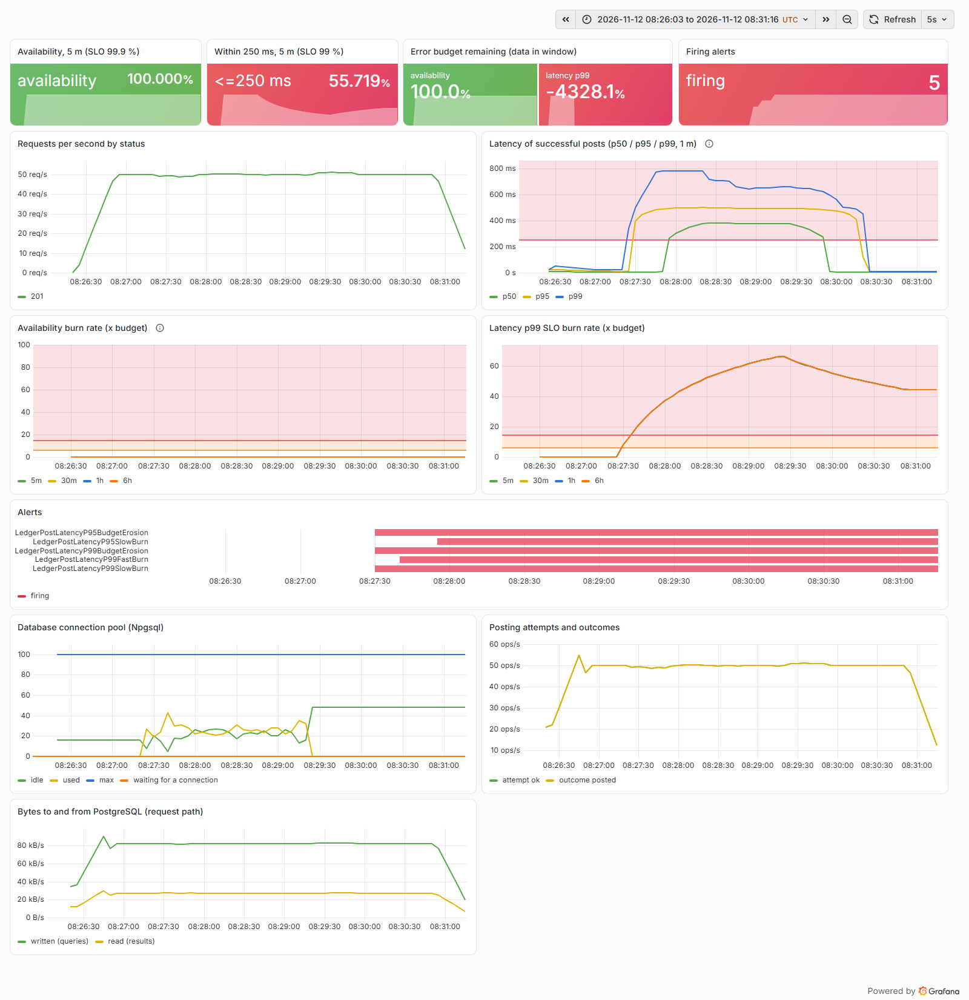
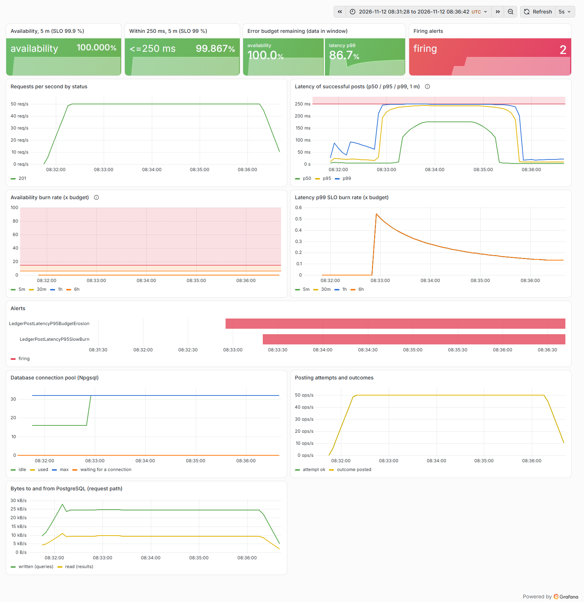

# Postmortem 1: +100 ms on the database link became +400 ms per post and burned the p99 budget at 66x

| | |
|---|---|
| Experiment | `latency`: Toxiproxy `latency` toxic on the database link, downstream, 100 ms, no jitter |
| Load | 50 posts/s fixed (open model), callers time out at 2 s; 60 s warm-up, 120 s fault, 90 s recovery |
| Runs | [latency-before.json](../results/latency-before.json) (baseline profile), [latency-after.json](../results/latency-after.json) (hardened profile) |
| Status | Resolved for the p99 objective; the p95 objective (100 ms) cannot hold when one round trip alone costs 100 ms |

Blameless: the subject is the system and its configuration, not a person.

## Hypothesis

A slower link between the service and PostgreSQL (a cross-zone hop after a failover, a congested network, a slow
proxy) adds the same delay to every database response. If posting were one round trip, +100 ms on the link would mean
roughly +100 ms per post and the 250 ms p99 objective would hold. We suspected it is not one round trip.

## Method

`sh scripts/run-experiments.sh latency`. The toxic delays every chunk PostgreSQL sends back by 100 ms; queries go out
undelayed. The API and Prometheus were recreated before each run.

## What the SLOs and the dashboard showed

Before (baseline profile, interactive posting as vendored from ledger-recon):

- p50 went from 5.3 ms to 408 ms, p95 450 ms, p99 606 ms (client-observed, exact). Only 0.4 % of posts finished within
  250 ms and 1.3 % within 100 ms. Nothing failed: availability stayed at 100 %.
- A median of about 4 x 100 ms is the signature of four sequential round trips: claim the idempotency key, lock the
  accounts, apply (update + insert in one batch), commit.
- The p99 SLO burned at 66x over 5 minutes. In the run's Prometheus `LedgerPostLatencyP99SlowBurn` fired after 10 s,
  `LedgerPostLatencyP99FastBurn` paged after 20 s, plus the p95 slow-burn page and both tickets. All cleared within
  105 s of the fault ending, as the short windows emptied.
- Steady-state model: on a service with a healthy hour behind it, two minutes of this would not page. 99.6 % slow posts
  for 120 s is 3.3 % of an hour's posts (3.3x over 1 h), below the 14.4x page; it would page after about 8.7 minutes
  (0.144 / 0.996 x 60 min). The run's short-history Prometheus paged after 20 s because its "1 h" window held only
  the run (ADR 0006).
- The pool panel shows the second effect: connections held across round trips grew the number of connections in use
  from about 1 to 20-40, because each post now held a connection (and its account row locks) for 400 ms.

After (hardened profile, `ledger.post_entry(...)` in one round trip):

- p50 105 ms, p95 109 ms, p99 166 ms. 99.7 % of posts within 250 ms: the p99 objective held (burn 0.5x) and no p99
  alert fired.
- The p95 objective (95 % within 100 ms) was still breached: with 100 ms added to the only round trip, 0.97 % of posts
  can finish within 100 ms. `LedgerPostLatencyP95SlowBurn` and the p95 ticket fired. That is correct: no change in
  the service can make a 100 ms link faster than 100 ms, and the alert is what buys time to fix the link.

## Impact and error budget

| | before | after |
|---|---:|---:|
| Fault-phase availability | 100 % | 100 % |
| Fault-phase p50 / p95 / p99 | 408 / 450 / 606 ms | 105 / 109 / 166 ms |
| Posts within 250 ms (fault phase) | 0.4 % | 99.7 % |
| Posts within 100 ms (server SLI, fault phase) | 1.3 % | 0.97 % |
| Budget consumed, latency p99 SLO | 0.461 % | 0.001 % |
| Budget consumed, latency p95 SLO | 0.092 % | 0.093 % |
| Max burn rate, p99 SLO (5 m) | 66.4x | 0.5x |
| Alerts fired (run's Prometheus) | P99 FastBurn (20 s), P99 SlowBurn, P95 SlowBurn, two tickets | P95 SlowBurn, P95 ticket |

## Root cause

The posting transaction is driven from the client, one statement at a time, because the result of the lock SELECT
decides what happens next. Four round trips per post multiply any link latency by four, and the account row locks are
held across three of them, so a slower link also means longer lock hold times and more connections in use.

## What went well

- The SLI and the alerts were exactly right: latency SLOs burned, availability did not, and the page named the p99 SLO.
- The dashboard made the multiplier visible: p50 at four times the injected delay.

## What went badly

- Nothing in the baseline service's own telemetry said "four round trips"; it took the experiment to see it. A
  per-request database round-trip count (from the Npgsql spans in the Aspire dashboard traces) would have shown it
  directly.

## Action items

| Action | Status |
|---|---|
| Move the posting transaction into one server-side function call (ADR 0005, migration 0003), hardened profile | done |
| Parity integration tests: both posting modes behave identically (posting, replay, key reuse, rejections, concurrency, invariants) | done |
| Port the function back to ledger-recon | open |
| Treat database placement as part of the latency SLO: a 100 ms link breaks the p95 objective whatever the code does | open: documented in the runbook |
