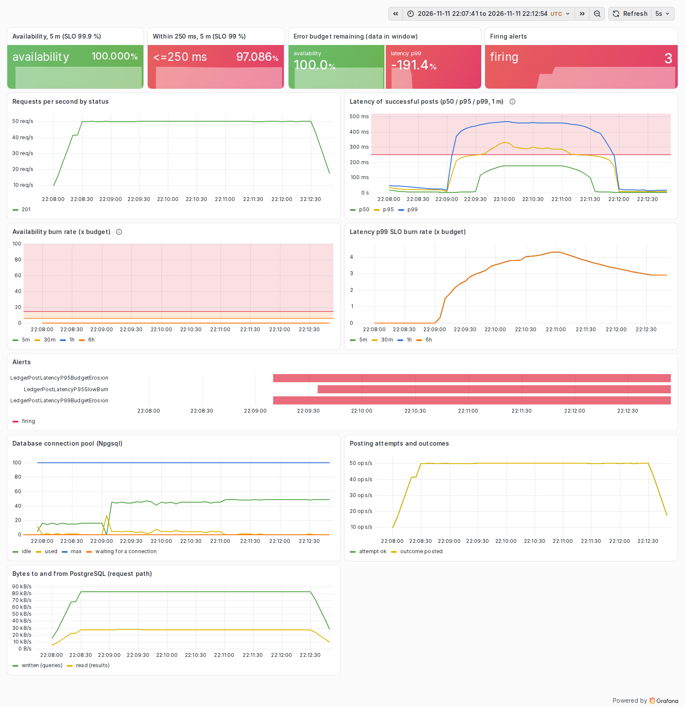
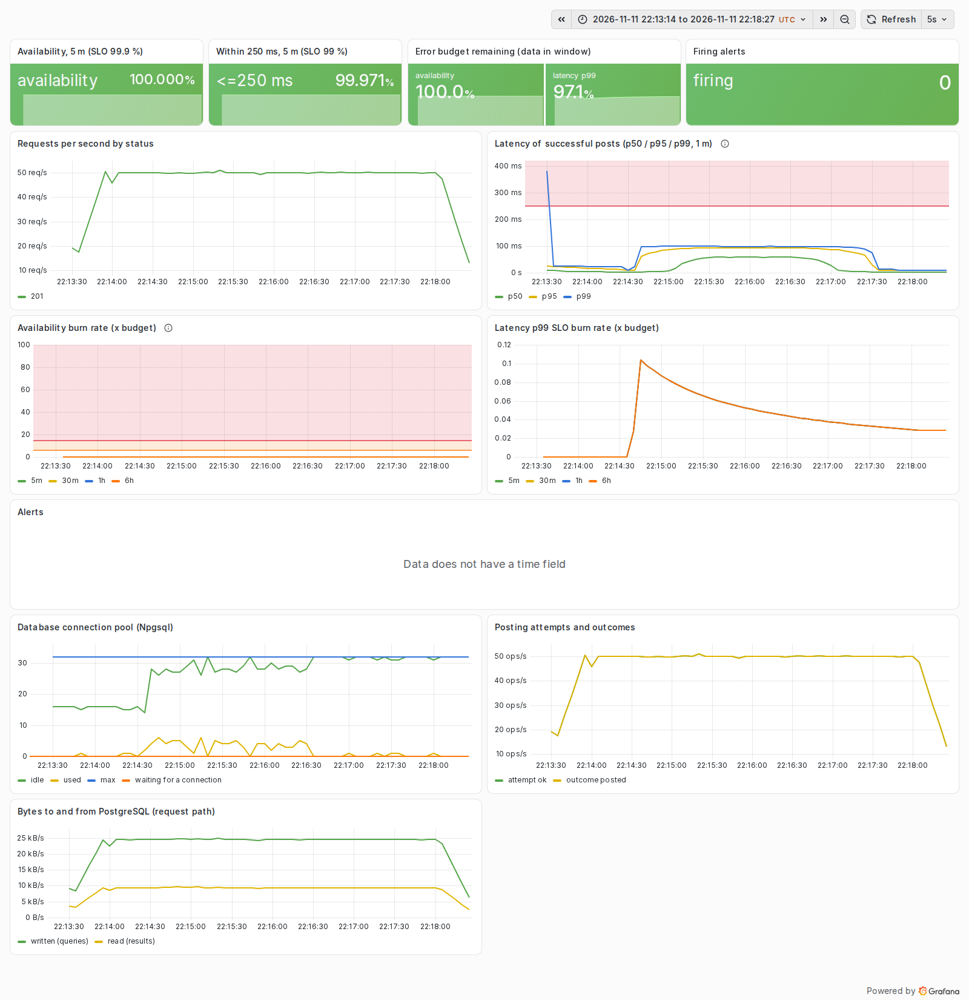

# Postmortem 2: database jitter pushes posting latency over the p95 and p99 objectives

| | |
|---|---|
| Experiment | `jitter`: Toxiproxy `latency` toxic on the database link, downstream, 40 ms +/- 40 ms (uniform 0-80 ms per response) |
| Load | 50 posts/s fixed (open model), callers time out at 2 s; 60 s warm-up, 120 s fault, 90 s recovery |
| Runs | [jitter-before.json](../results/jitter-before.json) (baseline profile), [jitter-after.json](../results/jitter-after.json) (hardened profile) |
| Status | Resolved by the experiment 1 fix (single-round-trip posting); no new code |

Blameless: the subject is the system and its configuration, not a person.

## Hypothesis

A link whose mean delay is moderate (40 ms) but whose spread is wide (0-80 ms) hurts the tail more than the median,
and the interactive posting protocol (four round trips, see postmortem 1) multiplies it: four independent delays per
request should push p95 well past 100 ms and p99 towards 250 ms. With one round trip, every percentile should stay
under 100 ms.

## Method

`sh scripts/run-experiments.sh jitter`. The fault was added 60 s into each run and removed after 120 s. The API and
Prometheus were recreated before each run. Numbers below are fault-phase values; full tables are in the JSON files and
[results/summary.md](../results/summary.md).

## What the SLOs and the dashboard showed

Before (baseline profile, interactive posting):

- p50 rose from 5.0 ms to 184 ms, p95 to 256 ms, p99 to 288 ms (client-observed, exact). 93.2 % of posts finished
  within 250 ms and only 4.6 % within 100 ms (server-side SLI), against objectives of 99 % and 95 %.
- No request failed: availability stayed at 100 % and no availability alert fired.
- The p95 and p99 latency SLOs burned budget: `LedgerPostLatencyP95SlowBurn` and the two `BudgetErosion` tickets fired
  in the run's Prometheus (10-35 s after the fault started). The page-level `FastBurn` did not fire: the p99 burn
  rate peaked at 4.3x over 5 minutes, below 14.4x. Replayed against a service with a healthy hour behind it, *no* alert
  would have fired for a two-minute episode (steady-state model). That is the policy working as designed: two minutes
  of jitter cost 0.032 % of the monthly p99 budget, not worth waking anyone.
- The dashboard's quantile panel shows p99 near 460 ms: histogram_quantile interpolates inside the 250-500 ms bucket.
  The SLI itself is not affected (it reads the 250 ms boundary); the exact client-side p99 was 288 ms.

After (hardened profile, one round trip):

- p50 59.7 ms, p95 81.5 ms, p99 86.0 ms. 99.93 % within 250 ms and 99.6 % within 100 ms: both objectives held during
  the fault. No alert fired.
- The median is higher than the toxic's 40 ms mean, most likely because a function response crosses the proxy in more
  than one chunk and each chunk draws its own delay, so the request waits for roughly the larger of several draws.

## Impact and error budget

| | before | after |
|---|---:|---:|
| Fault-phase availability (client) | 100 % | 100 % |
| Fault-phase p50 / p95 / p99 | 184 / 256 / 288 ms | 59.7 / 81.5 / 86.0 ms |
| Posts within 250 ms (fault phase) | 93.18 % | 99.93 % |
| Posts within 100 ms (server SLI, fault phase) | 4.6 % | 99.6 % |
| Budget consumed, latency p95 SLO | 0.09 % | 0 % |
| Budget consumed, latency p99 SLO | 0.032 % | 0 % |
| Max burn rate, p99 SLO (5 m) | 4.3x | 0.1x |
| Alerts fired (run's Prometheus) | P95SlowBurn, P95 and P99 BudgetErosion | none |

## Root cause

The interactive posting protocol pays every network delay four times and holds row locks while it waits. Jitter adds
variance on top of the mean: the sum of four uniform 0-80 ms delays averages 160 ms and spreads to almost 300 ms.

## What went well

- The burn-rate policy separated a real but small budget burn (ticket, slow-burn page in a short-history Prometheus)
  from an emergency. A threshold alert on p99 > 250 ms would have paged.
- The fix for experiment 1 covered this fault without new code.

## What went badly

- The dashboard's interpolated p99 overstated the tail; anyone reading only that panel would have over-estimated the
  impact. The panel description now says so, and the postmortems quote the exact client-side percentiles.

## Action items

| Action | Status |
|---|---|
| Single-round-trip posting (ADR 0005), via the hardened profile | done |
| Chart note: quantiles are interpolated, SLI reads exact bucket boundaries | done |
| Native histograms (exponential buckets) for tighter dashboard quantiles | open: listed in README limitations |
