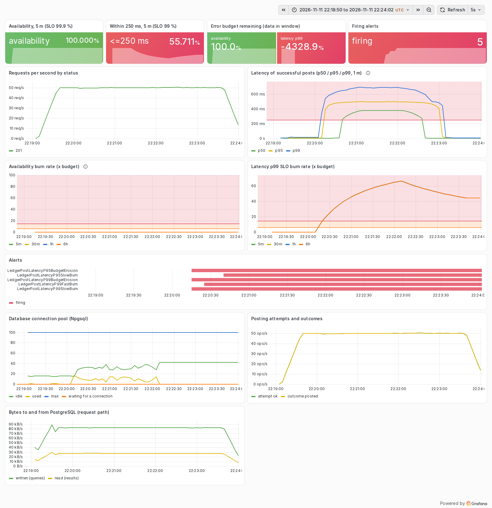
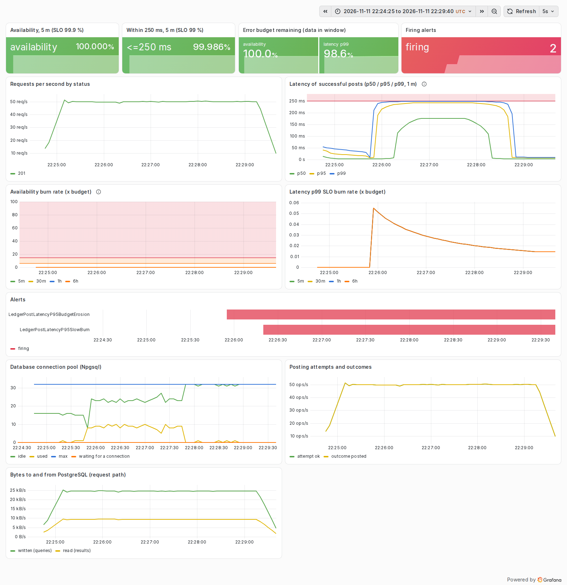

# Postmortem 3: a bandwidth cap on the database link makes every post cost 400 ms

| | |
|---|---|
| Experiment | `bandwidth`: Toxiproxy `bandwidth` toxic, upstream (service to PostgreSQL), 4 KB/s per connection |
| Load | 50 posts/s fixed (open model), callers time out at 2 s; 60 s warm-up, 120 s fault, 90 s recovery |
| Runs | [bandwidth-before.json](../results/bandwidth-before.json) (baseline profile), [bandwidth-after.json](../results/bandwidth-after.json) (hardened profile) |
| Status | Resolved for the p99 objective; the p95 objective (100 ms) is still breached under this cap |

Blameless: the subject is the system and its configuration, not a person.

## Hypothesis

A throttled link (a saturated VPN tunnel, a noisy-neighbour NIC, a metered cross-region hop) limits bytes per second
per connection. We expected two effects: latency proportional to the bytes each post sends, and, as requests slow
down, more concurrent connections until the pool (100 connections, 15 s wait in the baseline) queues requests and
callers start timing out.

## Method

`sh scripts/run-experiments.sh bandwidth`. The cap applies to the query direction only; results come back unthrottled.

## What the SLOs and the dashboard showed

Before (baseline profile):

- p50 418 ms, p95 449 ms, p99 615 ms; 0.32 % of posts within 250 ms. The p99 SLO burned at 66x over 5 minutes, and
  `LedgerPostLatencyP99FastBurn` paged 20 s into the fault in the run's Prometheus.
- No request failed. The second half of the hypothesis did not happen: the pool grew from about 16 to about 45
  connections and never queued a request ("waiting for a connection" stayed at 0). A per-connection cap scales with
  the number of connections, so opening more connections bought more total bandwidth.
- The "Bytes to and from PostgreSQL" panel explains the number: the service wrote about 83 kB/s of queries at
  50 posts/s, about 1.7 KB per post (four statements of SQL text plus parameters). At 4 KB/s that is roughly 415 ms of
  transmission per post, which is the measured p50.

After (hardened profile):

- The single function call writes about 25 kB/s at the same rate, about 0.5 KB per post: 3.3x fewer bytes.
- p50 127 ms, p95 130 ms, p99 220 ms; 99.97 % within 250 ms, so the p99 objective held and no p99 alert fired.
- The p95 objective (95 % within 100 ms) was still breached: 1.2 % of posts finished within 100 ms. 0.5 KB at 4 KB/s is
  125 ms; no client-side resilience mechanism can make a byte cross a link faster. `LedgerPostLatencyP95SlowBurn` and
  the p95 ticket fired, which is correct.

## Impact and error budget

| | before | after |
|---|---:|---:|
| Fault-phase availability (client) | 100 % | 100 % |
| Fault-phase p50 / p95 / p99 | 418 / 449 / 615 ms | 127 / 130 / 220 ms |
| Posts within 250 ms (fault phase) | 0.32 % | 99.97 % |
| Bytes written per post (dashboard, 50 posts/s) | about 1.7 KB | about 0.5 KB |
| Budget consumed, latency p99 SLO | 0.461 % | 0 % |
| Budget consumed, latency p95 SLO | 0.092 % | 0.092 % |
| Max burn rate, p99 SLO (5 m) | 66.4x | 0.1x |
| Alerts fired (run's Prometheus) | P99 FastBurn, P99 SlowBurn, P95 SlowBurn, two tickets | P95 SlowBurn, P95 ticket |

Steady-state model: on a service with a healthy hour behind it, no alert would have fired for this two-minute
episode in either variant (the 1 h window would hold 0.46 % of the budget, far below the 2 % that pages).

## Root cause

Latency on a bandwidth-limited link is bytes divided by rate. The interactive protocol sends its SQL text with every
statement, four statements per post, so it spends about 1.7 KB of the link per post.

## What went well

- The pool absorbed the slowdown without queueing, so a latency problem did not turn into an availability problem.
- The dashboard's bytes panel pointed straight at the cause; without it, this fault and experiment 1 look identical.

## What went badly

- Under a cap this tight the p95 objective is not achievable by any change inside the service. The right response is
  operational (fix or route around the link) and the alert gives the time to do that.

## Action items

| Action | Status |
|---|---|
| Single-round-trip posting: one statement, about 3.3x fewer bytes per post (ADR 0005) | done |
| Bytes-on-the-link panel on the SLO dashboard | done |
| Prepared statements (Npgsql `Max Auto Prepare`) to stop resending the SQL text | open: would trim the remaining bytes further |
