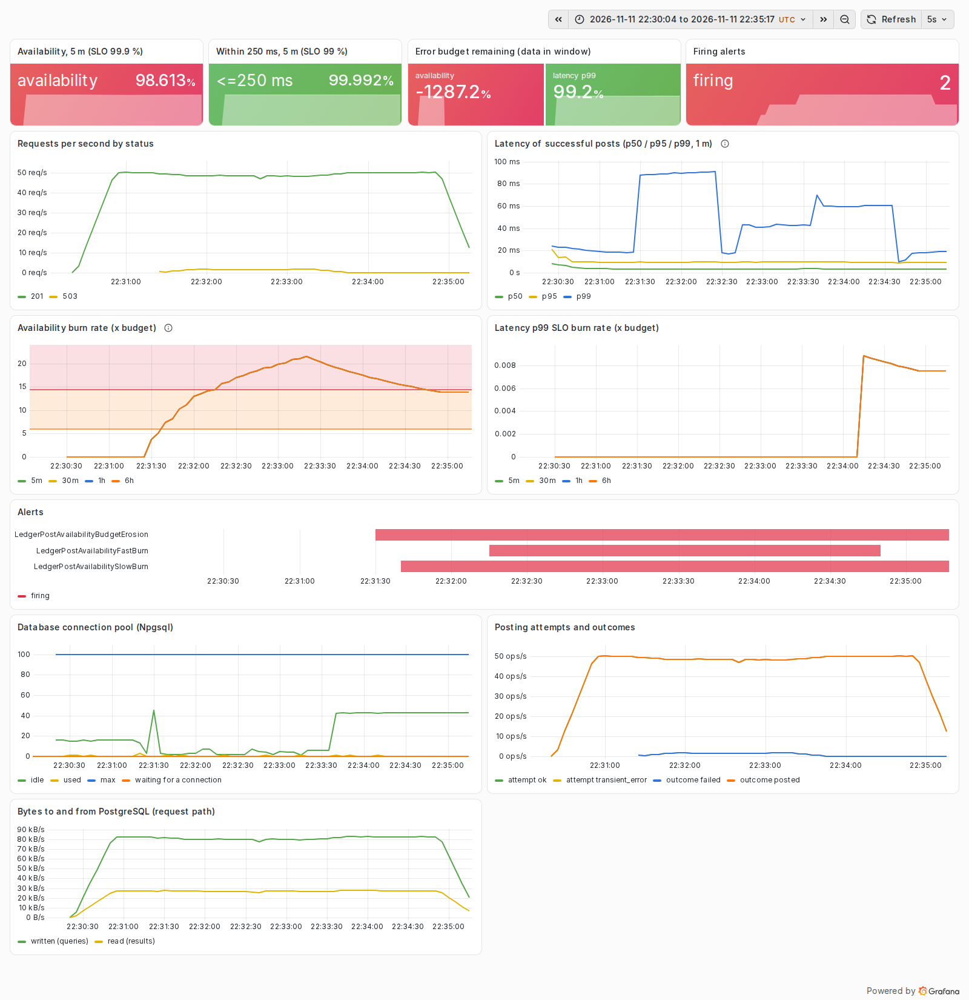
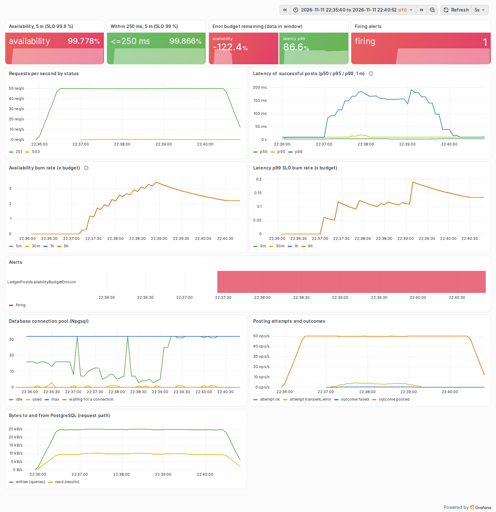

# Postmortem 4: TCP reset bursts fail 3 % of posts and page; retries make them invisible

| | |
|---|---|
| Experiment | `reset`: Toxiproxy `reset_peer` toxic (timeout 0), upstream, switched on for 500 ms every 10 s (12 bursts) |
| Load | 50 posts/s fixed (open model), callers time out at 2 s; 60 s warm-up, 120 s fault, 90 s recovery |
| Runs | [reset-before.json](../results/reset-before.json) (baseline profile), [reset-after.json](../results/reset-after.json) (hardened profile) |
| Status | Mitigated: failures down 83 %, no page; residual failures understood (see action items) |

Blameless: the subject is the system and its configuration, not a person.

## Hypothesis

A proxy or load-balancer restart, a NAT table flush or a database failover resets every connection that is sending
at that moment, while the database itself is healthy. The baseline service has no retries, so every post in flight
during a burst should fail with a 5xx, and connections reset in the pool should fail the next post that uses them.
Because a posting is idempotent, retrying with backoff should recover almost all of them without risking a double post.

## Method

`sh scripts/run-experiments.sh reset`. Each burst adds the toxic, waits 500 ms and removes it; the database never
goes away.

## What the SLOs and the dashboard showed

Before (baseline profile):

- 192 of 6,000 posts failed (96.8 % availability in the fault phase), about 16 per burst. Latency of the posts that
  succeeded was unaffected (p99 56 ms).
- The availability SLO burned at up to 21.5x over 5 minutes. In the run's Prometheus `LedgerPostAvailabilitySlowBurn`
  fired after 20 s and `LedgerPostAvailabilityFastBurn` paged after 55 s, clearing 85 s after the last burst: the short
  window doing its job.
- Steady-state model: with an hour of healthy traffic behind it, two minutes of this would not have paged. 192
  failures in a 1 h window of 180,000 posts is an error ratio of 0.11 % (1.1x burn), far below the 1.44 % (14.4x) that
  pages. At the fault's 3.2 % error rate (32x), the fast-burn page would need about 27 minutes of bursts
  (0.0144 / 0.032 x 60 min). A two-minute episode costs 0.148 % of the budget and is correctly a ticket, not a page.
- Server-side and client-side counts agree (177 + 15 = 192). The 15 that appear in the server's "warmup" row are the
  first burst's failures, counted by Prometheus at completion within the 2 s phase-boundary tolerance.

After (hardened profile: up to 3 retries, exponential backoff from 50 ms with jitter, inside a 1.5 s deadline):

- 32 of 6,000 posts failed (99.47 %), about 2.7 per burst; the availability burn peaked at 3.4x, and only the
  `BudgetErosion` ticket fired. No page.
- The retried posts paid for it in latency: p99 rose from 56 to 138 ms, still well inside the 250 ms objective.
- No double posts: every retry carries the original Idempotency-Key, so a retry after a commit whose acknowledgement
  was lost replays the stored entry. The integration test
  `Retries_ride_out_a_short_reset_burst_and_post_exactly_once` pins this.

## Impact and error budget

| | before | after |
|---|---:|---:|
| Failed posts (fault phase, client) | 192 | 32 |
| Fault-phase availability | 96.8 % | 99.47 % |
| Fault-phase p99 of successful posts | 56.4 ms | 138 ms |
| Budget consumed, availability SLO | 0.148 % | 0.025 % |
| Max burn rate, availability (5 m) | 21.5x | 3.4x |
| Alerts fired (run's Prometheus) | FastBurn (55 s), SlowBurn (20 s), ticket | ticket only |

## Root cause

Transient connection failures were surfaced to callers as 5xx because the posting path made exactly one attempt. The
failure was transient by construction: the next connection, a few milliseconds later, works.

## What went well

- Idempotency keys, introduced in ledger-recon for client retries, made server-side retries safe with no extra design.
- Retry attempts are visible on the dashboard ("attempt transient_error" next to "outcome posted"), so a rising retry
  rate shows up before it becomes failures.

## What went badly

- 32 posts still failed. A burst lasts 500 ms; three retries with a 50 ms base back off for roughly 50 + 100 + 200 ms
  (jittered), about 350 ms in total, so a post that arrives at the start of a burst can spend all its retries inside it.

## Action items

| Action | Status |
|---|---|
| Retries with exponential backoff and jitter on transient errors, bounded by the deadline (ADR 0004) | done |
| Integration test: a retry across a reset posts exactly once | done |
| Size the retry span to the fault it should ride out (e.g. a 150 ms base spans about 1 s, still inside the 1.5 s deadline) and re-measure | open |
| Ask callers to retry 503s with the same key and honour `Retry-After` (documented in the runbook) | done |
