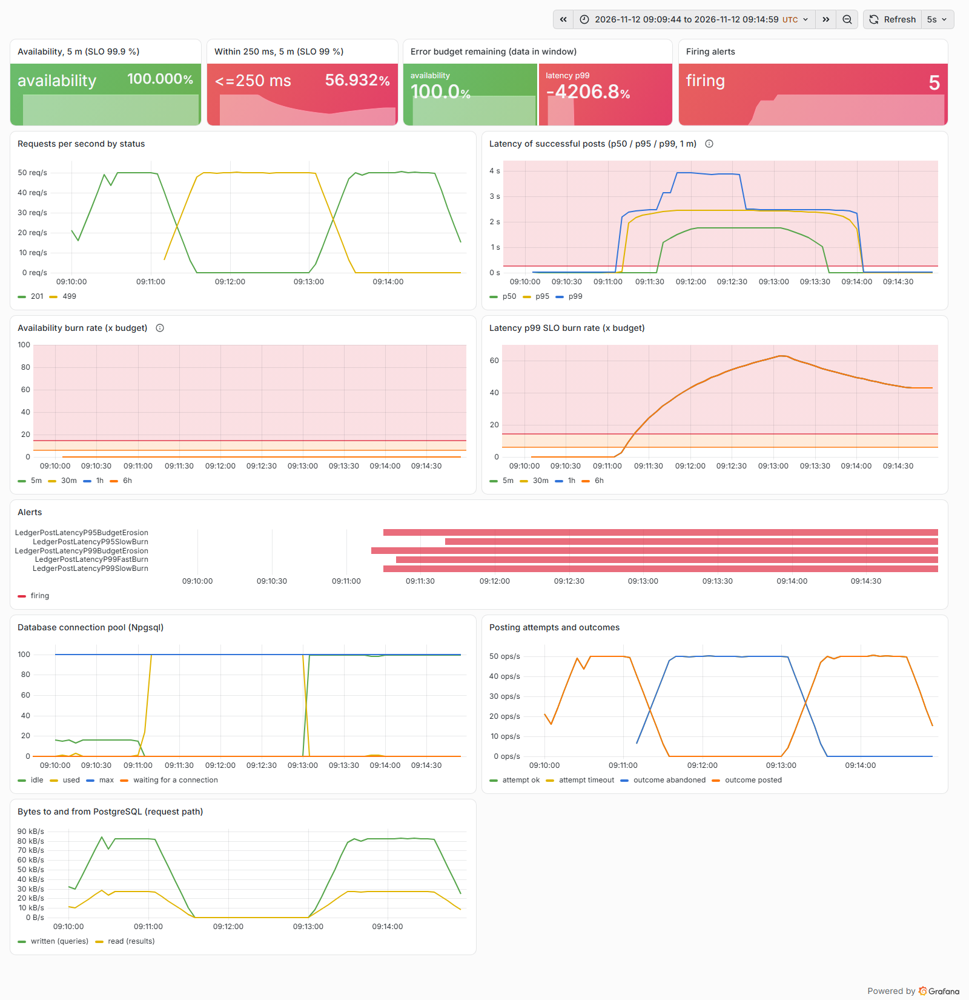
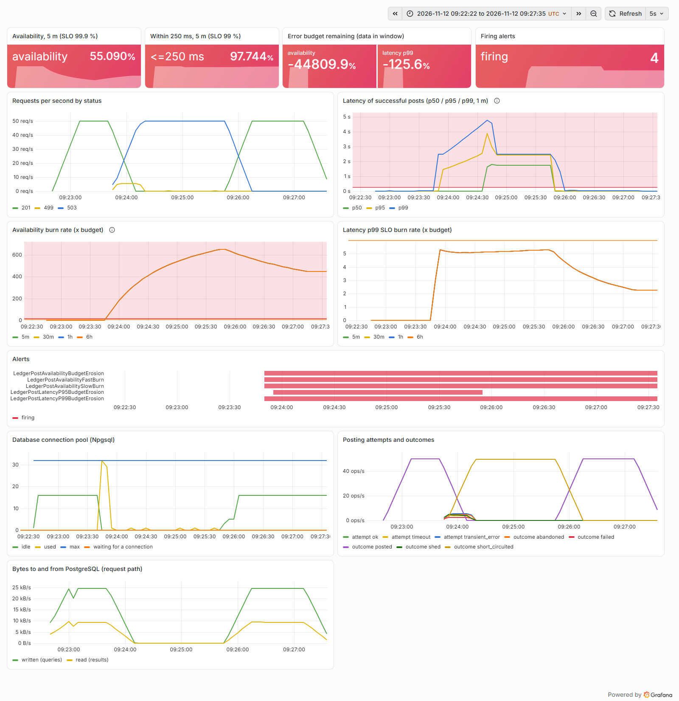

# Postmortem 5: a full partition took posting down and the availability SLO did not notice

| | |
|---|---|
| Experiment | `partition`: Toxiproxy `timeout` toxic with timeout 0 on both directions: every byte is silently dropped, nothing is refused or reset, connections stay open |
| Load | 50 posts/s fixed (open model), callers time out at 2 s; 60 s warm-up, 120 s fault, 90 s recovery |
| Runs | [partition-before.json](../results/partition-before.json) (baseline profile), [partition-after.json](../results/partition-after.json) (hardened profile), [trials/partition-after-hard-deadline.json](../results/trials/partition-after-hard-deadline.json) (a fix that was tried and reverted) |
| Status | Resolved: the outage is now visible to the SLI and pages; most callers fail in about 1 ms instead of 2 s. One gap remains open (see action items) |

Blameless: the subject is the system and its configuration, not a person.

## Hypothesis

A real partition drops packets; it does not politely refuse connections. With Npgsql defaults (15 s to connect or wait
for a pooled connection, 30 s per command) every request should hang until its caller gives up at 2 s. We expected
the availability SLO to burn at nearly 1000x and the fast-burn page to fire within about a minute.

## Method

`sh scripts/run-experiments.sh partition`. Both toxics were added at 60 s and removed at 180 s.

## What the SLOs and the dashboard showed

Before (baseline profile):

- Callers: 5,908 of 5,999 posts in the fault phase timed out at 2 s; 91 that were already past the database round
  trip succeeded. Client-observed availability 1.5 %, and 4.56 % of the 30-day availability budget gone in two minutes.
- **The availability SLI said 100 %.** Prometheus recorded no 5xx at all, but 5,908 responses with status **499**
  ("client closed request"). Each request was still waiting on the database when its caller hung up; ASP.NET Core
  recorded the abort as 499, and the availability SLI, which counts 5xx, does not count 499. The availability burn
  rate stayed at 0x and **no availability alert fired.**
- The only pages came from the latency SLOs: a 499 is a non-5xx request that took about 2 s, so it counted as a slow
  success and `LedgerPostLatencyP99FastBurn` fired 15 s into the fault. Right outcome, wrong reason: the alert said
  "slow" while callers were getting nothing at all.
- The pool panel shows the mechanism: within seconds all 100 connections were "used", each one stuck in a command that
  would never get an answer, and new requests queued for a connection (up to 15 s) behind them. The outcomes panel
  shows the service still "working" on abandoned requests long after the callers left.
- Replaying the availability alert over what callers actually experienced (steady-state model), the fast-burn page
  would have fired 54 s into the fault.

After (hardened profile):

- Callers: 5,814 posts got a 503 problem response and 186 timed out. Across the run, failed requests returned in
  0.96 ms at the median and 3.8 ms at p95 (NBomber failure statistics): after the first second the circuit breaker was
  open, so requests did not touch the network at all.
- The availability SLI now matches callers: 5,883 5xx out of 6,057 in the fault phase (server-side availability
  2.9 %), burn rate 652x. `LedgerPostAvailabilityFastBurn`, `SlowBurn` and the ticket all fired 10 s into the fault in
  the run's Prometheus; the steady-state model puts the fast-burn page at 52 s.
- Recovery cost: 254 posts failed in the first seconds after the partition healed, while the breaker waited out its
  5 s break and the pool discarded connections that had been black-holed. Clean traffic resumed 6 s after the fault
  ended (the baseline resumed after 1 s, because its hung requests simply completed).

## Impact and error budget

| | before | after |
|---|---:|---:|
| Fault-phase availability, client-observed | 1.52 % | 0 % |
| Fault-phase availability, server-side SLI | **100 %** (5,908 x 499) | 2.9 % (5,883 x 5xx, 174 x 499) |
| Latency of failed posts, p50 / p95 | 2,001 / 2,004 ms (caller timeout) | 0.96 / 3.8 ms |
| Budget consumed, availability (client / server) | 4.56 % / **0 %** | 4.83 % / 4.69 % |
| Max availability burn rate (5 m) | 0x | 652x |
| Availability page (measured / steady-state) | never / 54 s (only if measured at the client) | 10 s / 52 s |
| Recovery to clean traffic after the fault | 1 s | 6 s |

The hardened service spends slightly *more* budget (4.83 % against 4.56 %): nothing can succeed while the database is
unreachable, the baseline's 91 lucky in-flight posts did not happen, and recovery costs 254 posts. The win is not
fewer failures; it is that the failure is fast for callers, measured by the SLI and paged on.

## Root cause

Two things combined:

1. **No deadline shorter than the caller's.** With 15 s and 30 s database timeouts, the service was always slower to
   give up than its 2 s caller, so every failure ended as a client abort (499) rather than a server error (5xx).
2. **An SLI that only counts what the server answers.** A server-side availability SLI cannot see requests whose
   caller left first. This is a known limit of server-side SLIs (the SRE Workbook recommends measuring as close to the
   user as possible, e.g. at the load balancer); the lab's load generator measured from the caller and exposed it.

## A fix that was tried and reverted

186 posts (3 %) still outlived their caller in the hardened run, and an integration test showed why: the first request
on a black-holed pooled connection returns only after about 4 s, because Polly's timeouts are cooperative and Npgsql
needs its 2 s command timeout plus connection teardown to give the call back. The obvious fix was a hard deadline,
`await attempt.WaitAsync(token)`, abandoning the database call at the deadline. It was implemented, tested and run
against the same partition:

| | cooperative deadline (kept) | hard deadline (reverted) |
|---|---:|---:|
| Fault-phase client timeouts | 186 | 100 (+ 92 in recovery) |
| Failed posts, p95 latency | 3.8 ms | 1,502 ms |
| Budget consumed, availability (client) | 4.83 % | 4.89 % |

With the hard deadline, attempts ended with a plain cancellation, which the circuit breaker does not count as a
failure, so the breaker opened later and far more requests waited out the full 1.5 s. Fewer timeouts, but slower
failures for everyone else and slightly more budget spent. It was reverted; the readiness probe keeps a hard deadline,
where no breaker is involved. The trial's data is kept in `docs/results/trials/`.

## What went well

- The client-side measurement and the server-side read-back were collected side by side, so the 5,900-request gap
  between them was impossible to miss.
- The latency SLO paged anyway. Defence in depth, if accidental.
- A plausible fix was measured before it was kept, and the measurement said no.

## What went badly

- The SLO everyone would look at first said 100 % during a total outage.
- The remaining 186 slow failures are not fixed.

## Action items

| Action | Status |
|---|---|
| Request deadline 1.5 s < caller timeout 2 s, unit-tested ordering (ADR 0004) | done |
| Circuit breaker: fail fast with 503 + `Retry-After` while the database is unreachable | done |
| Npgsql `Command Timeout=2`, `Timeout=2`, `Cancellation Timeout=-1` (do not wait on a cancel request over a dead link) | done |
| Integration tests: 503 instead of hanging during a partition; breaker fails fast with Retry-After; readiness unhealthy within its probe deadline | done |
| Hard request deadline via WaitAsync | tried, measured, reverted (above) |
| Count deadline cancellations as breaker failures, then retry the hard deadline; or lower `Command Timeout` to 1 s | open |
| Measure availability at the edge (load balancer or client SDK) as well as in the service | open: listed in README limitations |
